# Military Spending and US Inflation: Exploring Economic Correlations

**Coddie Curry** (ccurry2024@fau.edu)

*Final Project for CAP5768 Introduction to Data Analytics, Fall 2025, Florida Atlantic University. Instructor: Dr. Fernando Koch.*

  

---

## Abstract

This project investigates the relationship between US military expenditures and domestic cost-of-living increases over 76 years (1947–2023). It combines Federal Reserve Economic Data (FRED) on defense spending with Consumer Price Index (CPI) data, and applies correlation analysis, linear regression, Granger causality testing and trend-based forecasting.

Military spending and the cost of living are very strongly correlated in levels (Pearson r = 0.983, p < 0.001), with defense spending accounting for 96.6% of the variance in the CPI index. However, the relationship weakens sharply when measured in growth rates (R² = 0.108) and essentially disappears when defense spending is measured as a share of GDP (R² = 0.012). This suggests that much of the correlation reflects shared long-term growth rather than a direct causal link.

**Keywords:** military spending, inflation, cost of living, economic correlation, purchasing power, time series analysis

---

## Repository Contents

| File | Description |
|---|---|
| [`final_project.ipynb`](final_project.ipynb) | Complete Jupyter notebook: data download, processing, exploration, modeling, visualization and projections |
| [`images/`](images/) | All figures produced by the notebook |
| [`requirements.txt`](requirements.txt) | Python dependencies |

## How to Run

```bash
git clone https://github.com/<your-username>/<repo-name>.git
cd <repo-name>
pip install -r requirements.txt
jupyter notebook final_project.ipynb
```

Run the cells from top to bottom. The **Data Setup** cell downloads the three FRED series and saves them as Excel files, so no data files need to be supplied. An internet connection is required for that first step. FRED revises its data from time to time, so a fresh run may differ slightly in the last decimal places.

---

## 1. Introduction

Recent decades have seen large increases in US military expenditures alongside significant rises in the domestic cost of living. Understanding whether these are related matters because it affects the economic wellbeing of hundreds of millions of Americans and has implications for national fiscal policy. This study begins with the intuition that sustained high military spending, operating as a form of deficit spending, could contribute to long-term inflationary pressure by diverting resources from productive domestic investment while injecting money into the economy without corresponding increases in consumer goods.

The leading research question is:

> *Does US military spending exhibit a measurable correlation with inflation rates and cost-of-living increases, and if so, what is the magnitude and predictability of this relationship?*

The topic is relevant to policymakers, economists and citizens because military budget decisions influence not only national security but also domestic economic stability, purchasing power and quality of life. Studies of the economic impact of military spending have focused largely on GDP or employment effects. This analysis instead examines the direct relationship with consumer price inflation over an extended 76-year timeframe, capturing long-term cumulative effects.

---

## 2. Proposal

This project explores how military expenditures relate to domestic inflation and cost of living in the United States from 1947 to 2023. It seeks to answer:

1. **What is the statistical correlation between military spending levels and cost-of-living indices?**
2. **Can military spending data predict future inflation trends?**
3. **What are the long-term implications of current spending trajectories?**

### Datasets

| Dataset | File | Source | Description |
|---|---|---|---|
| Military spending | `FDEFX.xlsx` | [FRED: FDEFX](https://fred.stlouisfed.org/series/FDEFX) | Federal Government National Defense Consumption Expenditures and Gross Investment. Quarterly, billions of dollars, seasonally adjusted annual rate (nominal). Independent variable. |
| Consumer Price Index | `US_inflation_rates.xlsx` | [FRED: CPIAUCSL](https://fred.stlouisfed.org/series/CPIAUCSL) | CPI for All Urban Consumers, monthly. Primary dependent variable for cost-of-living analysis. (The original project used the [Kaggle US Inflation Dataset](https://www.kaggle.com/datasets/pavankrishnanarne/us-inflation-dataset-1947-present), which is derived from this same series.) |
| Defense share of GDP | `military_gdp_percent.xlsx` | [FRED: A824RE1Q156NBEA](https://fred.stlouisfed.org/series/A824RE1Q156NBEA) | National defense spending as a percentage of GDP, quarterly. |
| Inflation metrics | `US_inflation_calculated.xlsx` | Generated | CPI plus month-over-month, year-over-year, 5-year, 10-year and annualized inflation rates. |
| Merged dataset | `merged_inflation_military.xlsx` | Generated | Annual dataset combining military spending with inflation metrics, temporally aligned for correlation analysis (77 annual observations, 1947–2023). |

---

## 3. Method and Results

### Experiment 1: Inflation Rate Metrics

**Research question:** How have different measures of inflation evolved over the study period, and what patterns emerge when comparing short-term and long-term inflation?

**Technique:** Multiple inflation metrics were calculated from raw CPI data using percentage-change formulas. Year-over-year inflation captures short-term volatility, while 5-year and 10-year cumulative rates capture longer-term purchasing power erosion. Annualized rates were computed using compound annual growth rate (CAGR) formulas to allow comparison across time horizons.

**Findings:** Year-over-year inflation peaked at 14.6% in 1980 and fell as low as −2.0% in 2009, averaging 3.7%. The 1970s and 1980s were the highest-inflation decades. Even though recent annual rates are lower, cumulative purchasing power loss has been severe: the CPI rose 1,318.5% between 1947 and 2023, and the dollar lost 93.0% of its 1947 purchasing power.

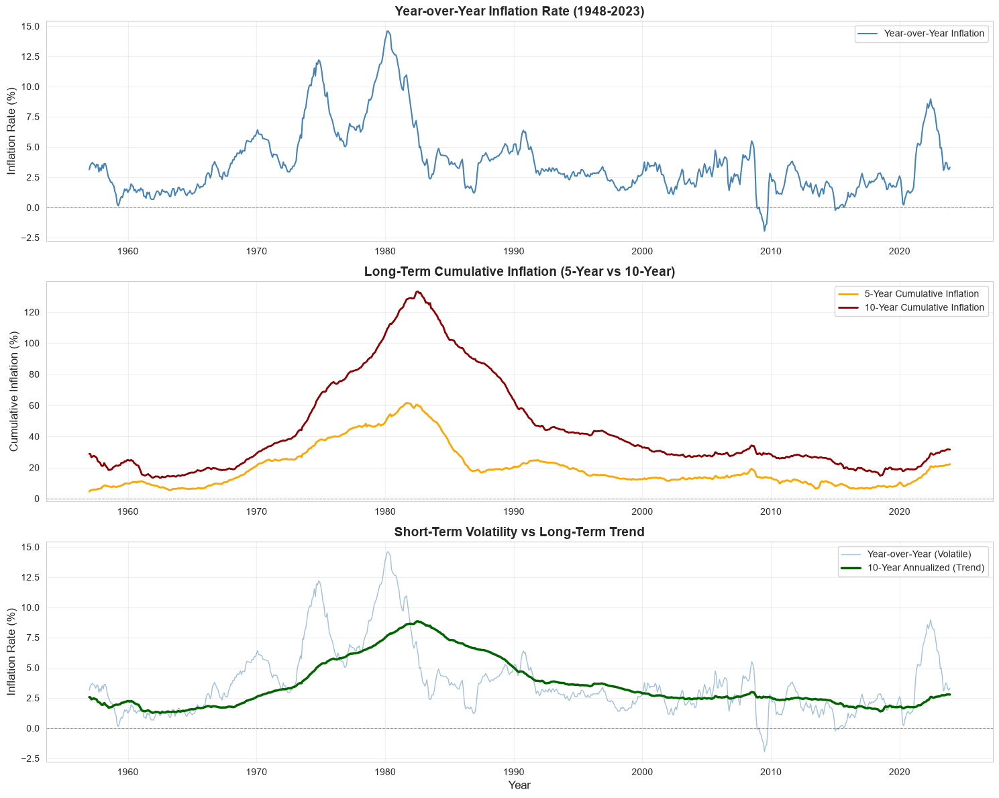

*Figure 1: Three perspectives on inflation. Year-over-year rates are volatile, with spikes during war periods and oil crises. Long-term cumulative rates (5-year and 10-year) smooth out short-term fluctuations. The comparison of year-over-year and 10-year annualized rates shows how short-term metrics can mask long-term purchasing power erosion.*

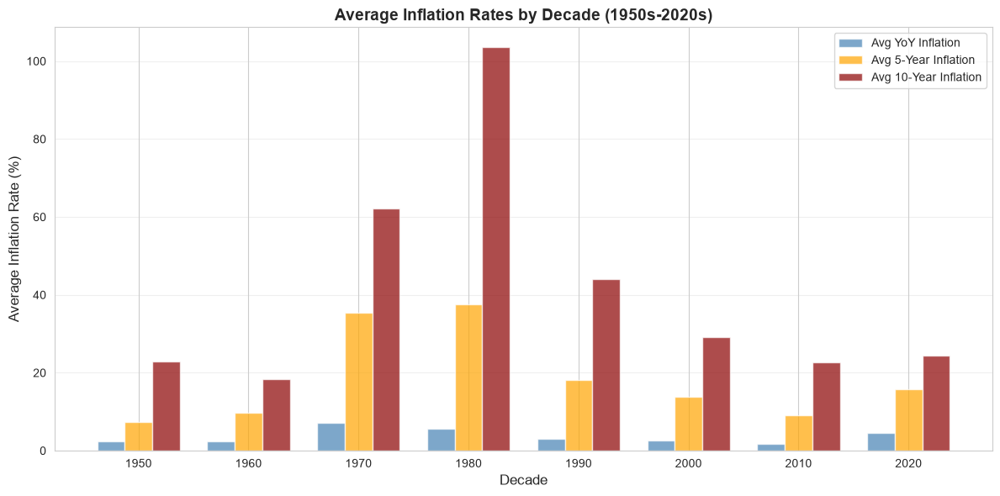

*Figure 2: Average inflation rates by decade.*

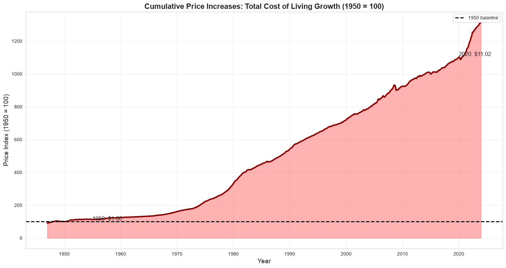

*Figure 3: Cumulative price increases since 1950. Even when the inflation rate falls, prices keep rising because inflation compounds on an ever-higher base.*

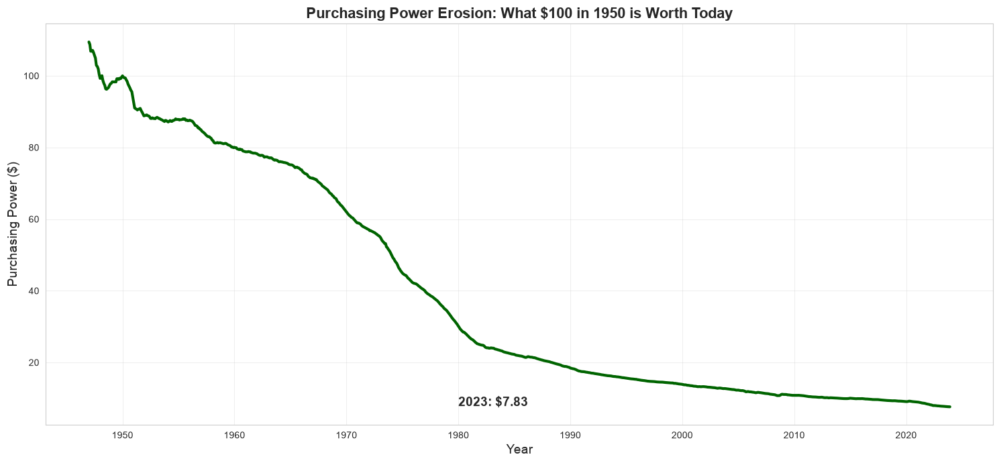

*Figure 4: Purchasing power of $100 from 1950 over time.*

---

### Experiment 2: Military Spending Trends and Patterns

**Research question:** How has US military spending evolved since 1947, and what temporal patterns line up with major geopolitical events?

**Technique:** Quarterly military expenditure data were analyzed by calculating annual averages, year-over-year growth rates, cumulative totals and decade-level aggregations. Time series visualizations highlighted spending patterns relative to major conflicts.

**Findings:** Annual military spending rose from $21.07 billion in 1947 to about $1.0 trillion ($1,002.56 billion) in 2023, a 47.6-fold increase in nominal terms. Cumulative spending over the period totaled about $26.9 trillion. Clear spending increases line up with the Korean War (1950–1953), the Vietnam War peak (1968), the Gulf War (1991) and the War on Terror era (2001–2021). Post–Cold War reductions in the 1990s reversed after 2001, and spending reached its highest level in 2023.

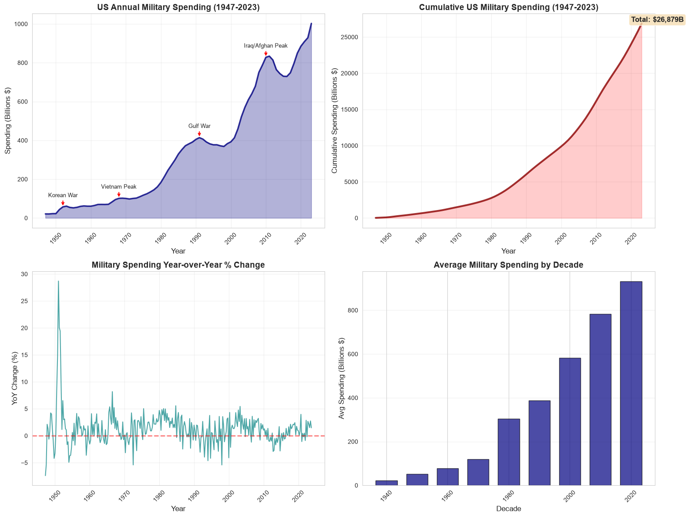

*Figure 5: Four views of military spending. Annual expenditures show war-related increases. Cumulative spending shows the total resources allocated to defense. Year-over-year percentage changes show volatility in budget decisions. Decade averages show the 2010s and 2020s as the highest-spending periods in nominal terms.*

---

### Experiment 3: Correlation and Regression Analysis

**Research question:** What is the statistical relationship between military spending and cost-of-living indices, and can military expenditures predict inflation trends?

**Technique:** Pearson and Spearman correlation tests quantified linear and monotonic relationships. Simple linear regression modeled the CPI index as a function of military spending. Multiple regression added time as a control variable. A third model tested the relationship in growth rates, and a fourth used defense spending as a share of GDP. Residual analysis checked model assumptions, and Granger causality tests examined predictive relationships.

**Findings:**

| Test / Model | Result |
|---|---|
| Pearson correlation (levels) | r = 0.983, p = 2.9 × 10⁻⁵⁶ |
| Spearman correlation (levels) | ρ = 0.986, p = 8.5 × 10⁻⁶⁰ |
| Model 1: CPI = f(Military Spending) | R² = 0.966; CPI = 89.44 + 1.3317 × Military Spending; RMSE = 72.2 |
| Model 2: CPI = f(Military Spending, Year) | R² = 0.983; military coefficient falls to 0.77 |
| Model 3: Inflation rate = f(Military Spending growth rate) | R² = 0.108 |
| Inflation rate = f(Military Spending % of GDP) | R² = 0.012; coefficient = −0.10 |
| Granger causality (military spending → inflation) | Not significant at lags 1–4; p = 0.047 at lag 5 only |

In levels, every $1 billion increase in military spending is associated with a 1.33-point increase in the CPI index (1947 = 100). However, several results point to the correlation being driven largely by both series growing over time:

- Adding year as a control cuts the military spending coefficient from 1.33 to 0.77.
- When both variables are measured as growth rates, military spending growth explains only 10.8% of the variation in inflation.
- Defense spending as a share of GDP has essentially no relationship with inflation, and the slope is slightly negative.
- Granger causality is significant only at a single lag (lag 5, p = 0.047), which is weak evidence of a predictive relationship.
- The residual plot shows clear patterns over time rather than random scatter, which is typical when two trending series are regressed on each other.

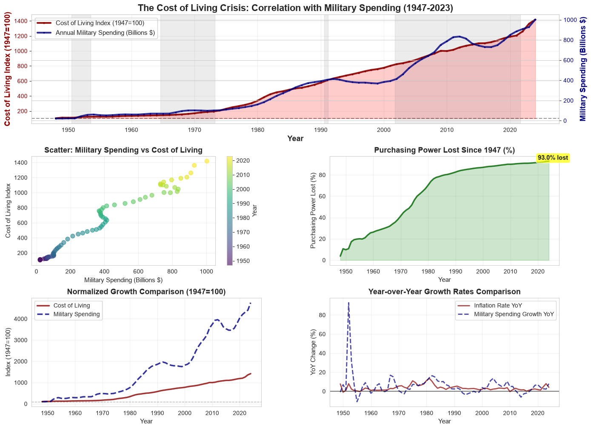

*Figure 6: Cost of living (red) and military spending (blue), 1947–2023. Gray shaded regions mark major war periods. The normalized comparison (both indexed to 1947 = 100) shows military spending growing about 4,658% while the cost of living grew about 1,319%.*

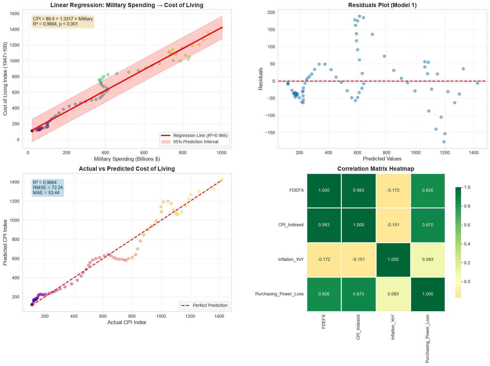

*Figure 7: Regression diagnostics. The scatter plot shows tight clustering around the fitted line, but the residuals plot shows systematic patterns, suggesting the linear model does not fully capture the relationship. The correlation heatmap shows that military spending is strongly correlated with the CPI level but weakly and negatively correlated with the year-over-year inflation rate (−0.17).*

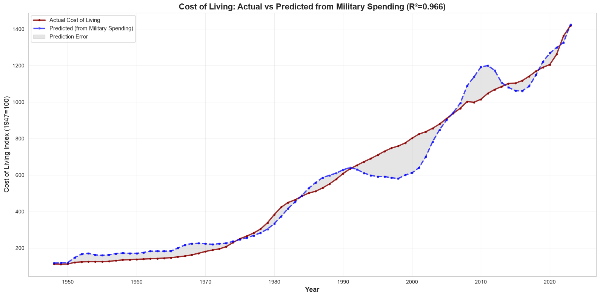

*Figure 8: Actual cost-of-living index compared with values predicted from military spending alone (R² = 0.966). The gaps around the 1990s and 2010s show periods when spending and prices diverged.*

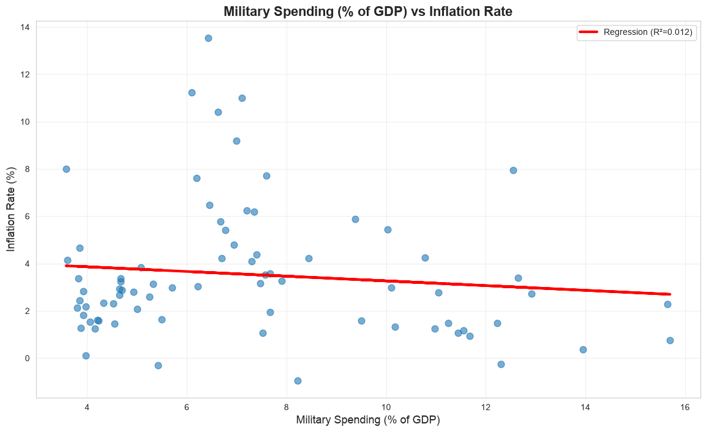

*Figure 9: Military spending as a share of GDP against the inflation rate. There is essentially no relationship (R² = 0.012).*

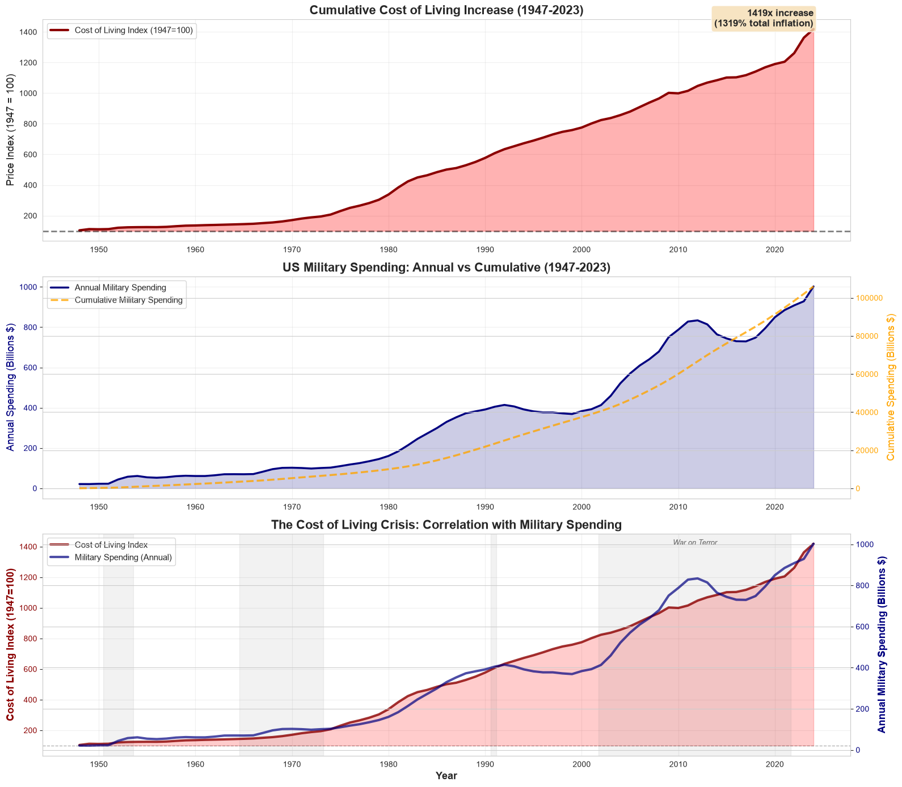

*Figure 10: Cumulative cost-of-living increase, annual and cumulative military spending, and the two series compared on a dual axis.*

---

## 4. Projections

### Short-term projections (2024–2030)

Military spending was projected forward using a linear time trend, and the CPI index was then projected from that spending using Model 1.

| Metric (2030) | Projection |
|---|---|
| Military spending | $916 billion |
| CPI index (1947 = 100) | 1,310 |
| Change from 2023 | −7.7% |

The linear trend fitted over 1947–2023 sits well below the actual 2023 spending level ($1,003 billion) because spending accelerated in recent decades. As a result, the model projects a *decline* from 2023, which is not realistic. These linear projections understate recent levels and should not be relied on.

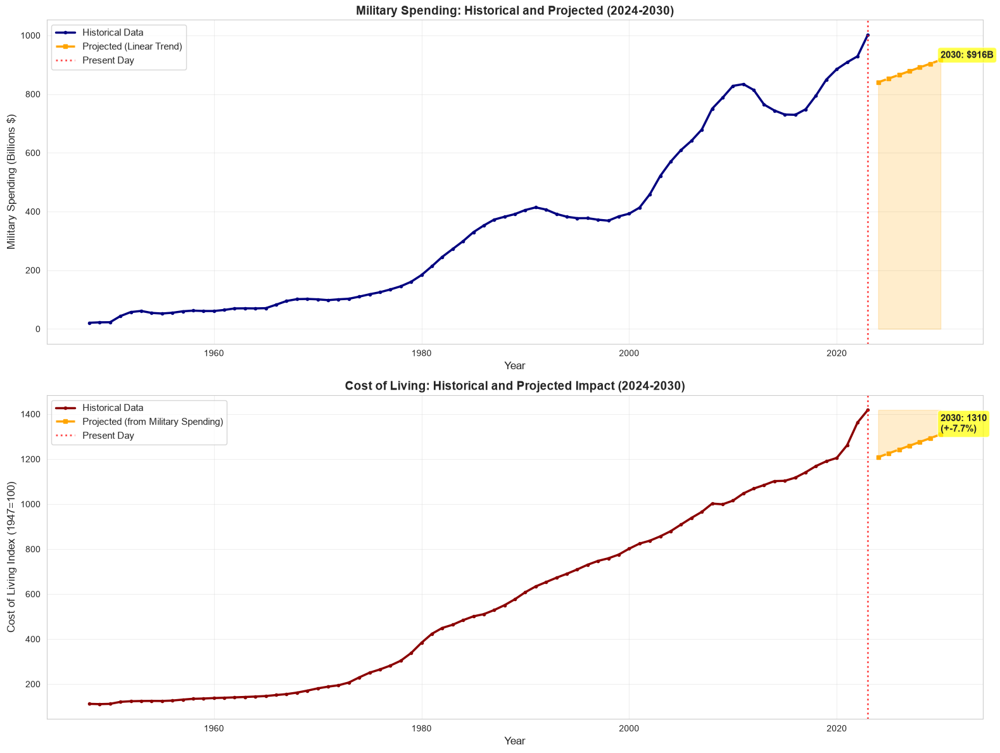

*Figure 11: Linear trend projections of military spending and the cost of living through 2030.*

### Long-term trend extrapolation (2024–2044)

Exponential trend models, fitted separately to military spending and the CPI index over time, give the following extrapolations:

| Metric | 2023 (actual) | 2034 | 2044 |
|---|---|---|---|
| Military spending | $1,003B | $2,280B (+127%) | $3,691B (+268%) |
| CPI index (1947 = 100) | 1,419 | 2,602 (+83%) | 3,813 (+169%) |
| Purchasing power lost since 1947 | 93.0% | 96.2% | 97.4% |

These are mechanical extrapolations of historical growth and assume past trends continue unchanged.

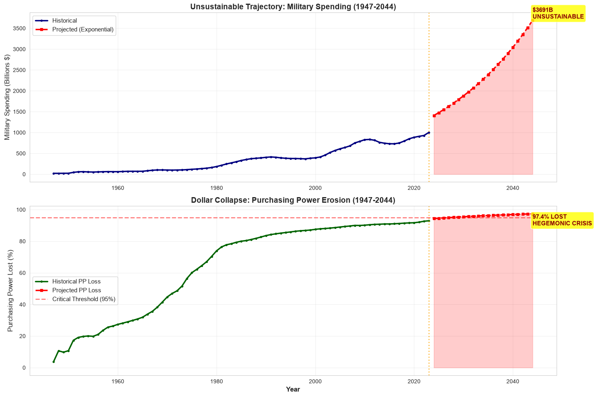

*Figure 12: Exponential trend extrapolation of military spending and purchasing power loss through 2044.*

---

## 5. Conclusion

This study set out to understand whether US military spending correlates with domestic inflation and cost-of-living increases. Using time series analysis, correlation testing and regression modeling across a 76-year dataset, it found a very strong positive correlation between defense spending and the consumer price level (r = 0.983, p < 0.001), with military spending accounting for 96.6% of the variance in the CPI index from 1947 to 2023.

Cumulative effects are large: the US dollar lost 93.0% of its purchasing power over the study period, while cumulative military spending reached about $26.9 trillion. Both series grew exponentially.

However, the evidence for a direct link is limited. The relationship weakens sharply when measured in growth rates (R² = 0.108), disappears when defense spending is measured as a share of GDP (R² = 0.012), and Granger causality is significant only at a single lag. The strong correlation in levels is therefore best explained largely by shared long-term growth: both prices and nominal spending rise as the economy grows. Military spending may contribute to long-term inflation, but this analysis does not establish that it drives it.

### Critical Reflection

The project quantified the relationship between military expenditures and inflation metrics using several statistical methods, and testing the relationship in more than one form (levels, growth rates and share of GDP) proved essential to interpreting it correctly. Important limitations include:

- **Causation:** Correlation does not prove causation. Other factors, including oil shocks, monetary policy and globalization, also influence inflation, and military spending may be one of several contributing factors.
- **Trending series:** Both series trend upward over time, so a high correlation in levels is expected even without a direct link (the spurious regression problem). Growth-rate and share-of-GDP tests are more informative.
- **Nominal values:** Military spending is measured in nominal dollars, so part of its growth is itself caused by inflation.
- **Scope:** The analysis uses aggregate spending and aggregate inflation. Future research could examine specific defense spending categories (personnel, procurement, R&D) and specific consumer sectors (housing, healthcare, education).
- **Projections:** Projections assume historical patterns continue. Structural economic changes, policy reforms or geopolitical shifts could change future relationships.

### Future Research Directions

1. Expand the analysis to international comparisons (NATO countries, China, Russia) to test whether the relationship holds across countries.
2. Add control variables such as interest rates, the money supply, federal deficits, energy prices, GDP growth and unemployment.
3. Use inflation-adjusted (real) military spending and stationary time series methods such as differencing, cointegration tests or VAR models.
4. Examine sector-specific impacts to understand which components of the cost of living are most associated with defense spending.
5. Investigate policy interventions that might change the observed relationship.

---

## References

- Federal Reserve Bank of St. Louis. *Federal Government: National Defense Consumption Expenditures and Gross Investment [FDEFX]*. FRED Economic Data. https://fred.stlouisfed.org/series/FDEFX
- Federal Reserve Bank of St. Louis. *Shares of gross domestic product: Government consumption expenditures and gross investment: Federal: National defense [A824RE1Q156NBEA]*. FRED Economic Data. https://fred.stlouisfed.org/series/A824RE1Q156NBEA
- U.S. Bureau of Labor Statistics. *Consumer Price Index for All Urban Consumers: All Items in U.S. City Average [CPIAUCSL]*. Retrieved from FRED, Federal Reserve Bank of St. Louis. https://fred.stlouisfed.org/series/CPIAUCSL
- Kaggle. (2023). *US Inflation Dataset (1947–Present)*. https://www.kaggle.com/datasets/pavankrishnanarne/us-inflation-dataset-1947-present

---

## Appendix: Dataset Features

**FDEFX dataset**
- `observation_date`: quarterly timestamps (1947-Q1 through 2023-Q4)
- `FDEFX`: military spending in billions of dollars (seasonally adjusted annual rate)
- 308 quarterly observations

**Inflation dataset**
- `date`: monthly timestamps (1947-01 through 2023-12)
- `value`: Consumer Price Index (1982–84 = 100)
- 924 monthly observations, processed to generate multiple inflation rate calculations

**Merged dataset**
- `year`: annual timestamp
- `FDEFX`: annual average military spending
- `CPI_Indexed`: cost-of-living index (1947 = 100)
- `Inflation_YoY`, `Inflation_5Y`, `Inflation_10Y`: inflation measures
- `Purchasing_Power_Loss`: cumulative purchasing power erosion (%)
- 77 annual observations (1947–2023)
